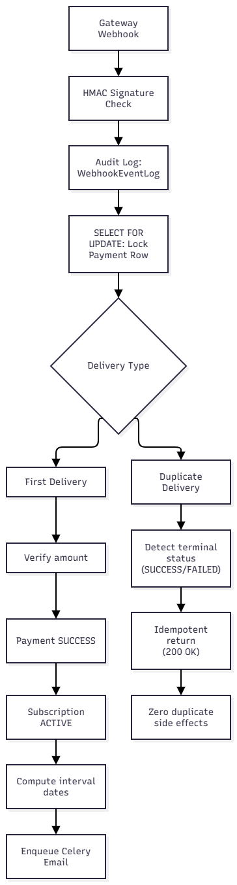

# Marketplace Subscription Backend

Production-grade Django REST Framework backend for a multi-tenant subscription marketplace where customers subscribe to recurring services provided by independent providers.

Engineered with PostgreSQL data integrity, idempotent payment webhooks, Celery task pipelines, Redis caching, and role-based access control (RBAC).

---

## 1. Quick Start & Installation

### Prerequisites

* Python 3.14+
* PostgreSQL 16+
* Redis 7+
* `uv` package manager (or `pip`)

### Local Setup

1. **Clone & Install Dependencies:**

   ```bash
   git clone https://github.com/mantle-bearer/marketplace-backend.git
   cd marketplace-backend
   uv sync
   ```

2. **Environment Variables:**
   Copy `.env.example` to `.env` and fill in your credentials:

   ```bash
   cp .env.example .env
   ```

3. **Database Setup (PostgreSQL):**
   Ensure your PostgreSQL database exists, then apply migrations:

   ```bash
   uv run python manage.py migrate
   ```

4. **Start the API Server:**

   ```bash
   uv run python manage.py runserver 0.0.0.0:8000
   ```

### Docker & Docker Compose

To run Django, PostgreSQL, Redis, Celery Worker, and Celery Beat in containers:

```bash
docker compose up --build
```

---

## 2. Environment Variables

Configure these in your `.env`:

| Variable | Description | Example / Default |
| :--- | :--- | :--- |
| `DEBUG` | Enable debug mode | `True` |
| `SECRET_KEY` | Django cryptographic secret | `your-secure-secret-key` |
| `ALLOWED_HOSTS` | Comma-separated hostnames | `localhost,127.0.0.1` |
| `DATABASE_NAME` | PostgreSQL database name | `marketplace_db` |
| `DATABASE_USER` | PostgreSQL user | `postgres` |
| `DATABASE_PASSWORD` | PostgreSQL password | `your_postgres_password` |
| `DATABASE_HOST` | PostgreSQL host | `127.0.0.1` |
| `DATABASE_PORT` | PostgreSQL port | `5432` |
| `REDIS_URL` | Redis instance URL | `redis://localhost:6379/0` |
| `CELERY_BROKER_URL` | Celery broker URL | `redis://localhost:6379/0` |
| `CELERY_RESULT_BACKEND` | Celery result backend | `redis://localhost:6379/0` |
| `WEBHOOK_SECRET` | HMAC-SHA256 signature secret | `super-secret-webhook-key` |
| `EMAIL_BACKEND` | Django mail backend | `django.core.mail.backends.console.EmailBackend` |

---

## 3. Redis Setup

Redis powers **catalog caching** and acts as the **Celery task message broker**.

* **Local (Linux/macOS):** `sudo systemctl start redis`
* **Local (Windows via WSL):** `sudo service redis-server start`
* **Docker:**

  ```bash
  docker run -d --name marketplace_redis -p 6379:6379 redis:7-alpine
  ```

---

## 4. Celery Worker & Celery Beat Setup

### Celery Worker (Background tasks)

Handles async non-blocking jobs such as sending customer payment confirmation emails:

```bash
uv run celery -A config worker --loglevel=info
```

### Celery Beat (Periodic scheduler)

Periodically identifies active subscriptions whose `end_date` has passed and transitions them to `EXPIRED`:

```bash
uv run celery -A config beat --loglevel=info
```

---

## 5. Running Tests

Run the full automated test suite (34 unit, integration, concurrency, and database constraint tests):

```bash
uv run python manage.py test
```

---

## 6. API Documentation & Minimal Examples

Interactive API documentation is generated via OpenAPI 3.0:

* **Swagger UI:** `http://localhost:8000/api/docs/`
* **Redoc:** `http://localhost:8000/api/redoc/`
* **Schema (YAML/JSON):** `http://localhost:8000/api/schema/`

### Authentication Approach

Stateless JWT authentication via `djangorestframework-simplejwt`. Tokens include user ID, email, and immutable role (`customer`, `provider`, or `admin`).

#### Register User

`POST /api/auth/register/`

```json
{
  "email": "kester@marketplace.dev",
  "password": "SecurePassword123!",
  "full_name": "Kester",
  "role": "provider"
}
```

*Returns JWT `access` and `refresh` tokens.*

#### Login

`POST /api/auth/login/`

```json
{
  "email": "kester@marketplace.dev",
  "password": "SecurePassword123!"
}
```

---

### Core Endpoints

#### 1. Create Plan (Provider)

`POST /api/plans/`  
*Header:* `Authorization: Bearer <provider_jwt>`

```json
{
  "name": "Kester DevOps Pro",
  "description": "High-availability managed cluster service",
  "price": "99.00",
  "billing_interval": "MONTHLY"
}
```

#### 2. List Active Plans (Public / Cached)

`GET /api/plans/`  
*Served directly from Redis cache.*

#### 3. Subscribe to a Plan (Customer)

`POST /api/subscriptions/`  
*Header:* `Authorization: Bearer <customer_jwt>`

```json
{
  "plan_id": "01943c22-7f11-7360-84a8-65ec4db1f148"
}
```

*Response (201 Created):*

```json
{
  "subscription_id": "01943c25-bb30-7988-9f20-8027a4e69b22",
  "payment_reference": "PAY-8F92A1439D0B",
  "status": "PENDING"
}
```

#### 4. Payment Gateway Webhook

`POST /api/payments/webhook/`  
*Optional Header:* `X-Webhook-Signature: <hmac-sha256-hex>`

```json
{
  "event": "payment.success",
  "reference": "PAY-8F92A1439D0B",
  "provider_reference": "STRIPE-ch_991823",
  "amount": "99.00"
}
```

*Response (200 OK):*

```json
{
  "status": "success",
  "payment_status": "SUCCESS",
  "subscription_status": "ACTIVE",
  "start_date": "2026-10-09T23:00:00Z",
  "end_date": "2026-11-08T23:00:00Z"
}
```

---

## 7. Payment & Webhook Architecture



### Idempotency Strategy

* **Unique Transaction Key:** Every subscription generates a unique reference (`PAY-...`).
* **Terminal State Guard:** If a payment is already `SUCCESS` or `FAILED`, subsequent duplicate webhooks exit immediately with `idempotent_duplicate` and 200 OK without re-activating subscriptions or re-sending emails.
* **Audit Trail:** Every incoming payload is stored in `WebhookEventLog`.

### Concurrency Strategy

* **Row-Level Locks (`select_for_update()`):**
  - `SubscriptionService.create_subscription()` locks the `Plan` record to prevent simultaneous deactivation races.
  - `PaymentWebhookService.process_webhook()` locks the `Payment` record inside `transaction.atomic()`, strictly serializing concurrent gateway events.
* **Periodic Task Safety:** Expiry task uses `select_for_update(skip_locked=True)` so concurrent Celery workers do not lock each other out.

---

## 8. Database Design & Optimization


[Link to design board](https://dbdiagram.io/d/Marketplace-BE-6ac8e13950a8c6fc361128d7)

### Strong PostgreSQL Constraints

Integrity is guaranteed at the database engine level rather than relying solely on application checks:

1. **Partial Unique Constraints:**

   * `unique_active_subscription_per_customer_plan`: Prevents two `ACTIVE` subscriptions for the same customer and plan.
   * `unique_pending_subscription_per_customer_plan`: Prevents multiple concurrent `PENDING` subscriptions for the same customer and plan.
2. **Check Constraints:**
   * `plan_price_non_negative`: `price >= 0`
   * `payment_amount_non_negative`: `amount >= 0`
   * `subscription_dates_consistent`: `end_date >= start_date`
   * `user_email_verified_consistent`: Enforces `email_verified=True` requires `email_verified_at IS NOT NULL`.
   * Valid enum values enforced on roles, intervals, and statuses.

### Indexing Decisions

* **`User`:** Indexes on `role`, `email`, and `created_at`.
* **`Plan`:** Indexes on `provider`, `is_active`, `billing_interval`, and composite `(is_active, created_at)` for high-throughput public browsing.
* **`Subscription`:** Indexes on `customer`, `plan`, `status`, `end_date`, and composite `(status, end_date)` enabling $O(\log N)$ Celery Beat expiry sweeps.
* **`Payment`:** Indexes on `reference` (unique key), `subscription`, and `(status, created_at)`.

### Caching Strategy

* Public active plans are cached in Redis (`marketplace:plans:active_list`) with a 15-minute TTL.
* Cache is automatically evicted on plan creation, update, or deletion via `invalidate_plans_cache()`.
* Parameterized queries (filters/search) bypass the cache and execute optimized database queries.

---

## 9. Architecture & Bonus Features

* **Service-Layer Pattern:** Views remain thin. All transactional workflows live in `SubscriptionService` and `PaymentWebhookService`.
* **UUIDv7 Primary Keys:** All models use time-sortable native UUIDv7 for primary keys, preventing ID enumeration and maintaining indexing performance.
* **Structured Logging:** Standardized logging output with timestamp, log level, module, and line number.
* **Celery Retries:** Email tasks feature automatic exponential backoff (`max_retries=3`).
* **Webhook Signature Verification:** Optional HMAC-SHA256 signature verification via `X-Webhook-Signature` header.

---

## 10. Assumptions & Trade-offs

1. **Fixed Billing Durations:** `MONTHLY` intervals are calculated as +30 days and `YEARLY` as +365 days. Production systems can swap this for calendar-aware arithmetic (`python-dateutil`).
2. **Simulated Gateway:** The `PAY-...` reference acts as the integration contract between external payment gateways (Stripe/PayPal) and internal subscription states.
3. **Pure PostgreSQL:** The backend relies strictly on PostgreSQL for production and testing to take full advantage of partial unique indexes and transactional locks.
